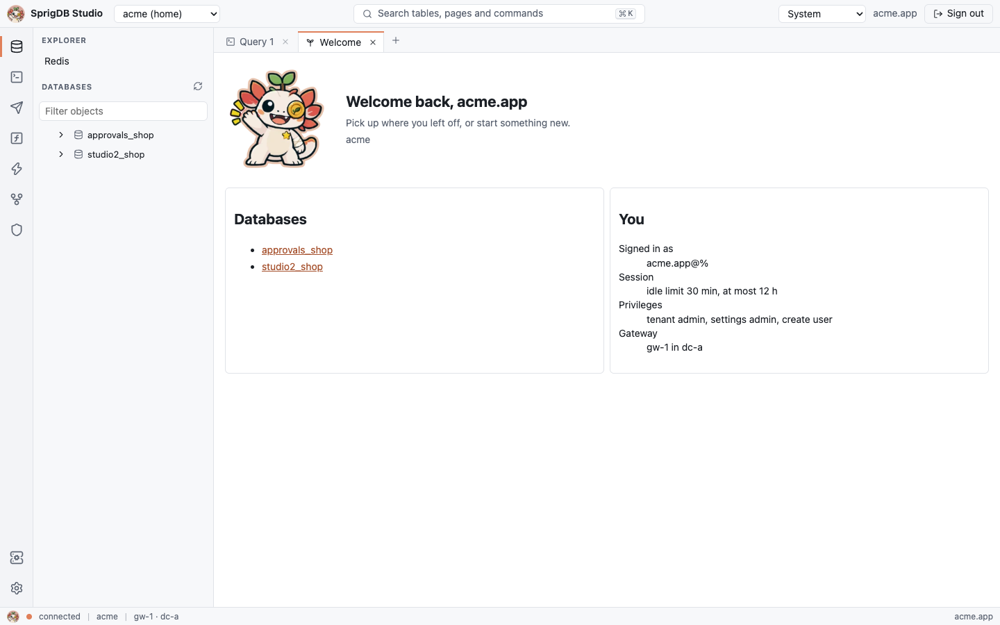
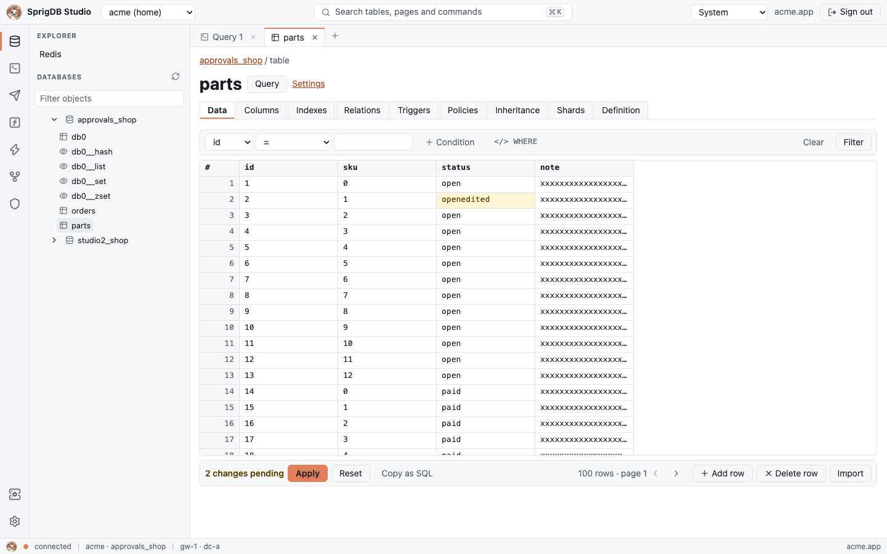
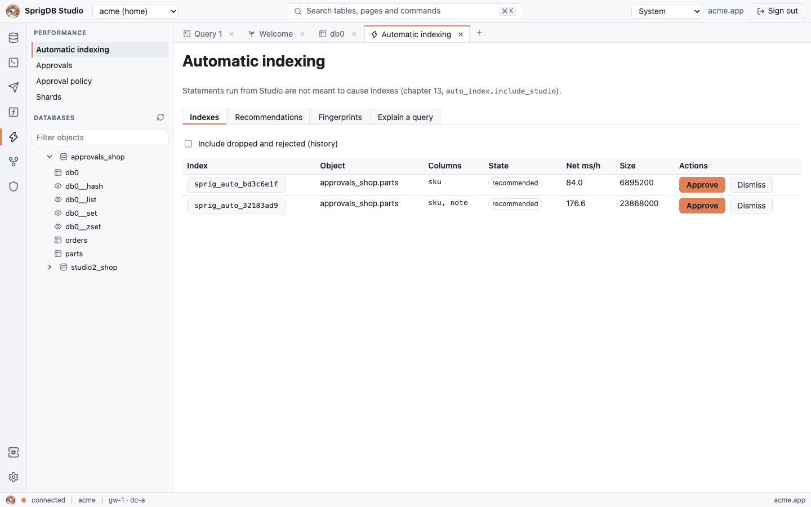
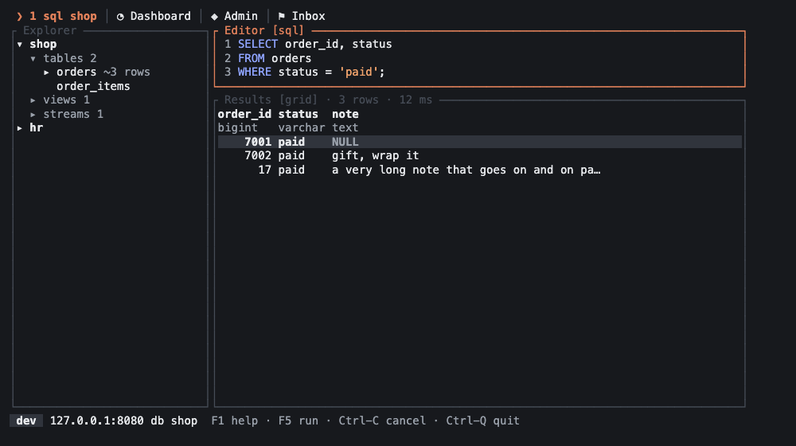

<p align="center">
  
</p>

<h1 align="center">SprigDB</h1>

<p align="center">
  <b>One database for every data model. It runs itself.</b><br>
  An open-source, multi-model, multi-data-centre database, built in Rust as a layer over MariaDB.
</p>

<p align="center">
  <a href="LICENSE"></a>
  
  
</p>

---

Say hello to **Sprig** 👋, the axolotl on this page. Axolotls regrow what they lose, and SprigDB aims to do the same for your data: it moves, reshapes and heals itself so you don't have to.

Your applications connect as they already do, with a MySQL or MariaDB driver, `mongosh`, `redis-cli`, a Neo4j driver or a Kafka client. Behind that, SprigDB keeps everything in MariaDB and takes care of what normally needs a DBA:
- deciding where data lives;
- splitting it into shards;
- creating indexes;
- surviving a failed node or a whole data centre.

## Why SprigDB

- **Many models, one store.** Tables, documents, key-value, vectors, graphs, streams and queues, all in MariaDB, joinable in one query.
- **Your drivers just work.** MySQL 8.4 and MariaDB personas, the MongoDB 8 wire protocol, Redis (RESP), Neo4j Bolt, Kafka and AMQP, plus REST and gRPC.
- **Sharding without a DBA.** Tenants start on one shard. SprigDB learns the workload, chooses the keys, and splits, merges and moves shards online.
- **Indexes from your queries.** Repeated slow queries get indexes that are designed, checked on a replica, rolled out and retired automatically.
- **Many data centres.** Routing, moves, residency pins and safe failover across sites, on Galera, primary with replicas, a single node or managed MariaDB.
- **Multi-tenant by design.** Tenant trees, inherited settings, row-level security, and isolation enforced by MariaDB's own grants.
- **Logic next to the data.** Functions and triggers in KIRun, JavaScript or Lua, and sinks to other systems.
- **You stay in charge.** Every automatic decision can run on its own, wait for your approval, or only recommend.
- **Studio and `sprig`.** A browser workspace and a terminal shell with the same calm, coral-gold look.

## A look inside

| Studio | Editing a table |
|---|---|
|  |  |
| **Automatic indexing** | **`sprig`, the terminal UI** |
|  |  |

## Quick start

You need Docker with Compose v2, and Rust: `rust-toolchain.toml` pins the version, and rustup installs it on first use.

```sh
# 1. MariaDB (single node, primary with replicas, and Galera) and etcd
cd deploy/compose && docker compose --profile all up -d --wait && cd -

# 2. A controller and a gateway on your machine
deploy/compose/gateway-dev.sh up

# 3. Connect with any MySQL or MariaDB client, as user app of the sample tenant acme
mysql -h 127.0.0.1 -P 13306 -u acme.app -psprig-dev-app \
      --ssl-mode=VERIFY_IDENTITY --ssl-ca=deploy/compose/gateway-certs/ca.pem
```

```sql
CREATE DATABASE shop;
CREATE TABLE shop.orders (id INT PRIMARY KEY, status VARCHAR(20), total DECIMAL(10,2));
INSERT INTO shop.orders VALUES (1, 'paid', 42.50);
SELECT * FROM shop.orders;
```

The gateway makes two sample tenants, `acme` and `globex`, each with a user `app`. Port 13307 is the MariaDB persona.

To try **Studio**, run Studio's test setup, `deploy/compose/studio/e2e.sh setup`. It turns on the HTTP listener and adds sample data; then open <http://127.0.0.1:18080/studio> and sign in as `acme.app`. The **`sprig`** shell is `cargo run -p sprig-shell --bin sprig -- --url http://127.0.0.1:18080 -u acme.app`.

These credentials are for local development only. Never reuse them.

## Documentation

- **[Concepts](docs/concepts/)**: what SprigDB is and how it works: tenants, clusters, shards, automatic indexing, approvals.
- **[Get started](docs/get-started/)** and **[Connect](docs/connect/)**: run it, then connect with MySQL, MongoDB, Redis, Bolt, Kafka, AMQP or REST.
- **[SQL](docs/sql/)**, **[Data models](docs/data-models/)**, **[Performance](docs/performance/)**, **[Security](docs/security/)**: using it.
- **[Operate](docs/operate/)**, **[Tools](docs/tools/)**, **[Troubleshooting](docs/troubleshooting/)**: running it.
- **[Reference](docs/reference/)**: every setting, error code, metric, REST route and command. These pages are generated from the code, so they always match this release.
- **[Developing SprigDB](docs/operate/development.md)**: building from source, the local environments, running a single role, the tests.

The same pages are published as a website, with search and a PDF download, from [`site/`](site/).

## Project status

SprigDB is under active development, and not yet ready for production. The protocols, sharding, automatic indexing, multi-data-centre failover, Studio and `sprig` all work today. Expect changes before 1.0.

## Building from source

```sh
cargo build --workspace
cargo test --workspace
cargo clippy --workspace --all-targets -- -D warnings
cargo fmt --all --check
```

See [Developing SprigDB](docs/operate/development.md) for everything else.

## Licence

SprigDB is licensed under the [Apache License 2.0](LICENSE). See [NOTICE](NOTICE).

<p align="center">
  
</p>
