# Studio tour

Studio is SprigDB's browser workspace, served by every gateway at `/studio`. This tour signs in, finds its way around the workspace, runs a query, browses and edits a table, saves a query, and changes a setting and the theme. It takes about fifteen minutes. Every screen is described in full in [Studio](../tools/studio.md).

## Before you start

You need a gateway with its HTTP listener on, and a login. On the [Quick start](quick-start.md) stack, turn the HTTP listener on and add sample data with:

```sh
deploy/compose/studio/e2e.sh setup
```

Studio is then at <http://127.0.0.1:18080/studio>, and you can sign in as `acme.app` with the development password `sprig-dev-app`. That password is for local development only.

On a deployment, Studio is at `https://<gateway>:8443/studio` (and `http://<gateway>:8080/studio`, which accepts sign-ins only from the gateway's own machine).

## 1. Sign in

Open `/studio`. The page **Sign in to SprigDB** asks for:

- **User**: your login, `tenant.user`, such as `acme.app`;
- **Password**.

Select **Sign in**. If your tenant requires a second factor, Studio asks for the 6-digit code from your authenticator app next.

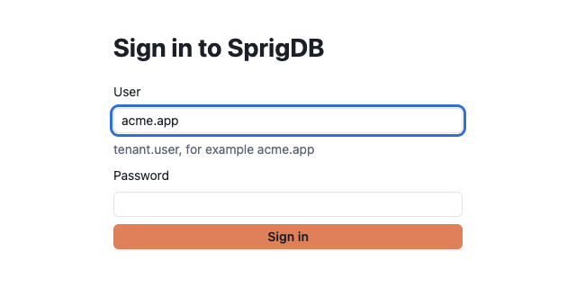

Studio refuses to send a password over plain HTTP from another computer: the sign-in button is turned off and the page says to use `https`. Signing in over HTTP from the gateway's own machine (`127.0.0.1`) is allowed, which is how local development works.

You see exactly what your grants allow. Studio calls the same public API any client would, with your own token.

## 2. The workspace

```text
┌ SprigDB Studio   acme ▾   [Search tables, pages and commands  Ctrl+K]   Theme  acme.app  Sign out ┐
├──┬──────────────────┬──────────────────────────────────────────────────────────────────────────┤
│▣ │ Databases        │ [Welcome] [Query 1] [orders]                                             │
│▶ │  Filter objects  │                                                                          │
│★ │  ▸ shop          │   the open tab                                                           │
│⟲ │                  │                                                                          │
│… │                  │                                                                          │
│⚙ │                  │                                                                          │
├──┴──────────────────┴──────────────────────────────────────────────────────────────────────────┤
│ ● connected | acme · shop | gateway · data centre                                    acme.app  │
└────────────────────────────────────────────────────────────────────────────────────────────────┘
```

| Part | What it does |
|---|---|
| **Title bar** | The tenant (a switcher, if you administer tenants below yours), the search box that opens the command palette, the theme, who you are, and **Sign out** |
| **Activity bar** (left) | Picks a section: **Explorer**, **Query**, **Saved queries**, **History**, **Messaging**, **Logic**, **Performance** (its badge counts approvals waiting for you), **Inheritance**, **Access control**, and at the bottom **Settings** (and **Operator mode**, for operators) |
| **Side panel** | The section's pages and the database tree, or the saved-query and history lists |
| **Tabs** | Everything you have open: query tabs, tables and pages. `Left` and `Right` move between tabs; `Delete` or a middle click closes one |
| **Status bar** | Whether you're connected, the tenant and database, the gateway and its data centre, and your login |

After you sign in, the **Welcome** tab greets you, lists your databases, and shows who you are signed in as, your session limits, your privileges and the gateway you reached.

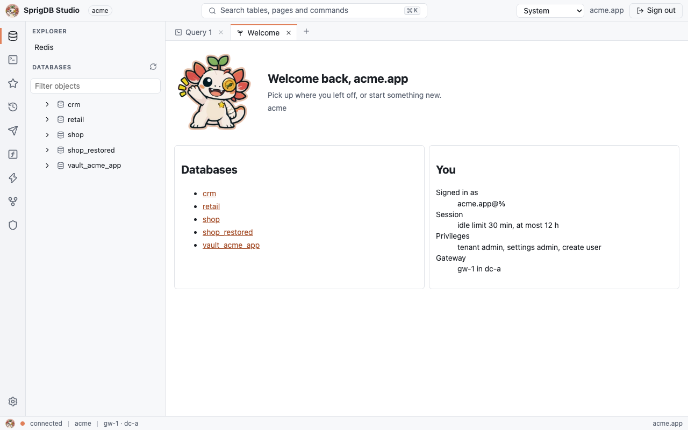

### The command palette

Press `Ctrl+K` (`⌘+K` on a Mac), or `Ctrl+P`, or select the search box. Type part of a name to find pages, open tabs, databases, the tables and other objects of databases you have opened in the tree, and commands such as **New query tab**, **Switch theme** and **Sign out**. `Up` and `Down` choose, `Enter` opens, and `Escape` closes.

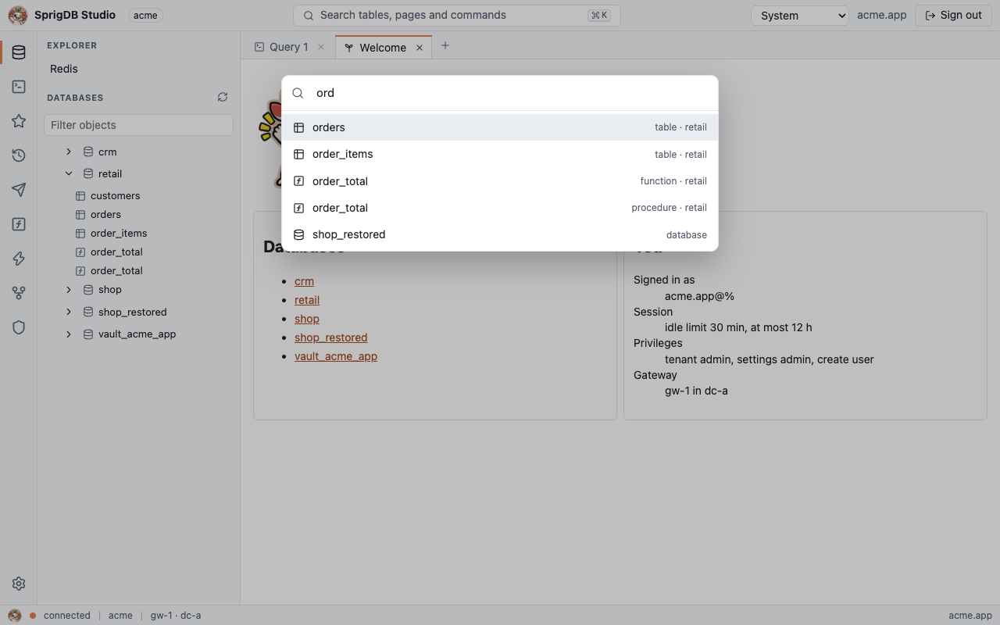

Try it now: press `Ctrl+K`, type `new`, and press `Enter` to open a query tab.

## 3. Run a query

A query tab has an editor, a **Language** (SQL, Cypher, GQL or MongoDB) and a **Database**. With SQL selected, type into the editor:

```sql
CREATE DATABASE IF NOT EXISTS shop;
```

Select **Run** (`Ctrl+Enter`, `⌘+Enter` on a Mac). Because it is DDL, Studio first shows **Run this statement?** with the statement and where it runs. Choose **Run it**. Which statements ask first is set by `studio.confirm_writes` (by default, DDL, account statements and anything Studio can't classify).

Now choose `shop` as the tab's **Database**, and run, with **Run all**:

```sql
CREATE TABLE orders (
  id BIGINT PRIMARY KEY,
  customer_id BIGINT NOT NULL,
  status VARCHAR(20) NOT NULL,
  total DECIMAL(10,2) NOT NULL
);
INSERT INTO orders VALUES (1, 42, 'paid', 42.50), (2, 42, 'open', 18.00), (3, 7, 'paid', 7.25);
SELECT status, COUNT(*) AS orders, SUM(total) AS total FROM orders GROUP BY status;
```

What to notice:

- **Run** runs the selection, or the statement at the cursor. **Run all** runs every statement in the tab, in order.
- As you type, the editor completes keywords, tables and columns, and marks errors such as an unknown column before you run anything.
- The result appears below as a **Grid**, with a **Chart** view for numbers. Errors show their code and a trace id.
- **Explain** shows the plan of the statement at the cursor.
- **Cancel** stops a running statement. Statements also stop at `studio.statement_timeout_ms` (30 seconds by default).
- A result holds up to `studio.max_result_rows` (10,000) rows in the browser. **Fetch more** continues, and **Export CSV** or **Export NDJSON** downloads every row.

The query below joins `orders` to `customers` and groups by country. Its result opens as a grid; **Chart** draws the same rows as a bar or line chart, with the first column as the categories.

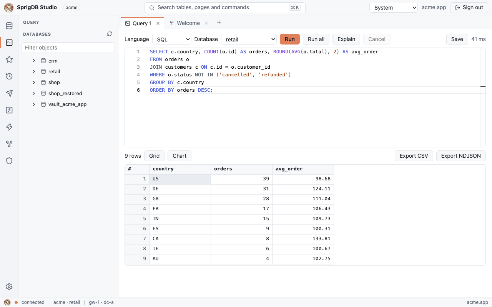

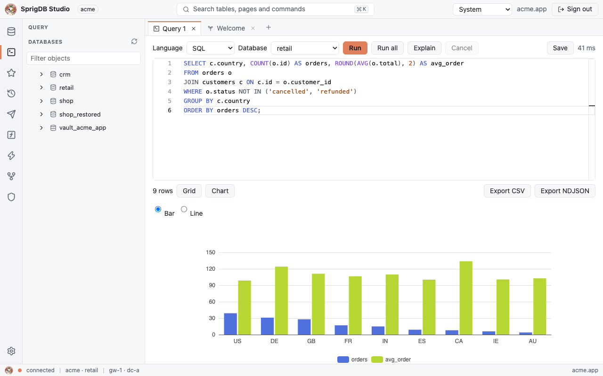

Statements you run in Studio don't count toward [automatic indexing](../concepts/automatic-indexing.md), so exploring doesn't build indexes.

## 4. Browse and edit a table

In the **Explorer**, expand `shop` (use **Refresh** if it isn't there yet) and choose `orders`. The table's page opens with tabs: **Data**, **Columns**, **Indexes**, **Relations**, **Triggers**, **Policies**, **Inheritance**, **Shards** and **Definition**. Choosing the database itself opens its page, which lists its tables, functions and procedures with their estimated rows.

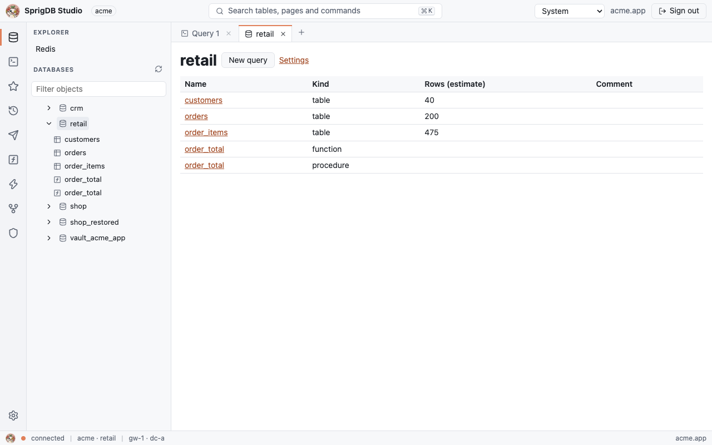

**Data** shows 100 rows at a time in primary-key order.

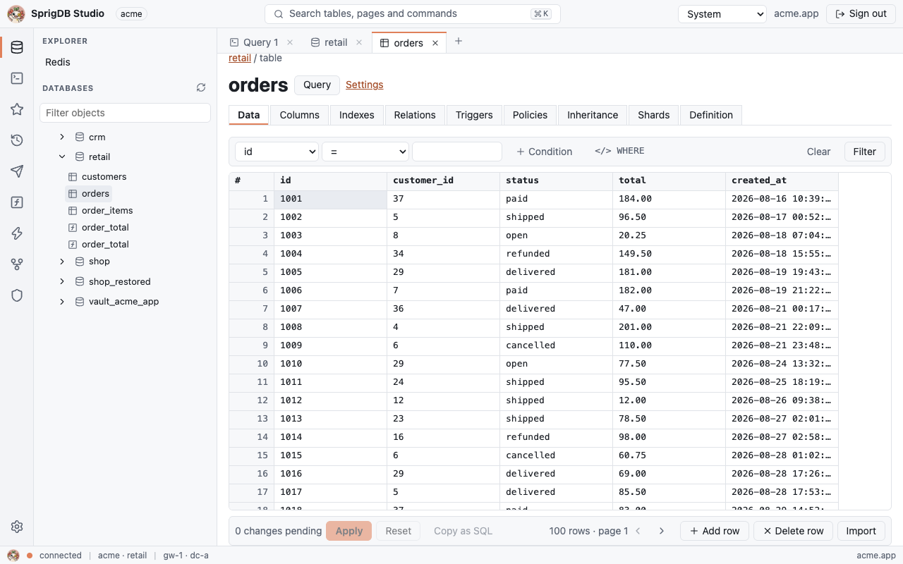

To filter, pick a **Column**, an operator and a **Value** in the filter bar and select **Filter**, for example `status` `=` `paid`. **Condition** adds another condition, and **Clear** shows every row again. Or switch to **</> WHERE** and type the clause yourself.

To edit:

1. Double-click a cell (or press `Enter` or `F2`), type a new value, and press `Enter`. `Escape` drops the edit.
2. **Add row** and **Delete row** stage new and deleted rows the same way.
3. The bar counts the changes pending. **Apply** shows the statements Studio will run; **Run them** runs them all in one transaction.

Changed cells are highlighted, and a row marked for deletion is struck through:

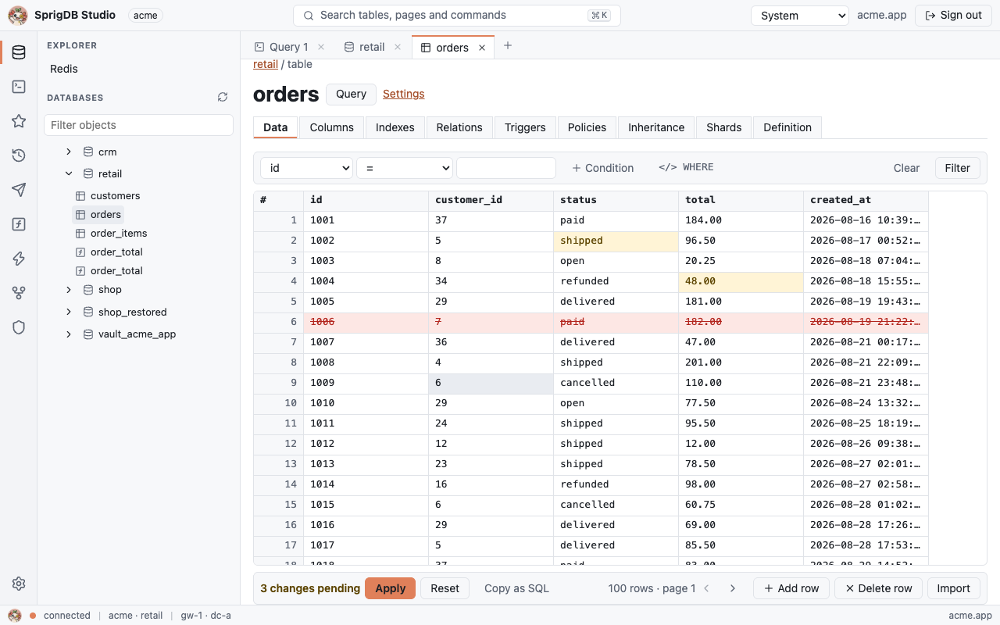

**Apply** shows the statements first, with **Run them** and **Cancel**:

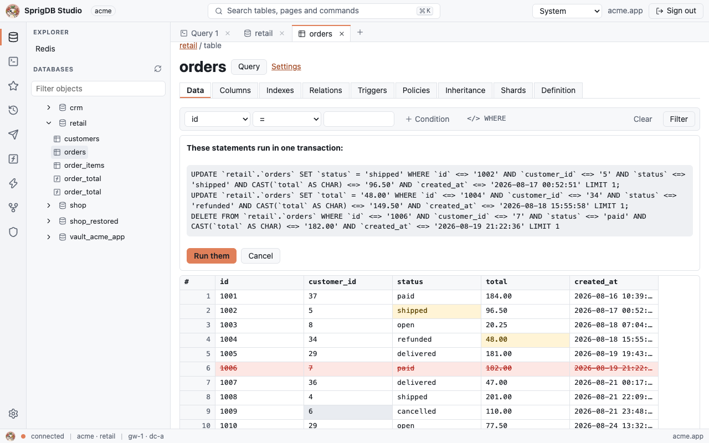

Each statement names its row by every column as you read it. If someone changed the row since, nothing is overwritten: Studio says **Someone changed these rows since you read them** and shows the original, the current and your version. Choose **Keep mine (save against current)** or **Take current**.

A table without a primary key is read-only here.

## 5. Saved queries and history

Every statement you run is kept in your **History** (the clock in the activity bar). Choose an entry to open it in a query tab.

To keep a query, press `Ctrl+S` (`⌘+S`) in its tab, or select **Save**, and give it a name. It appears under **Saved queries** (the star), and the tab takes its name.

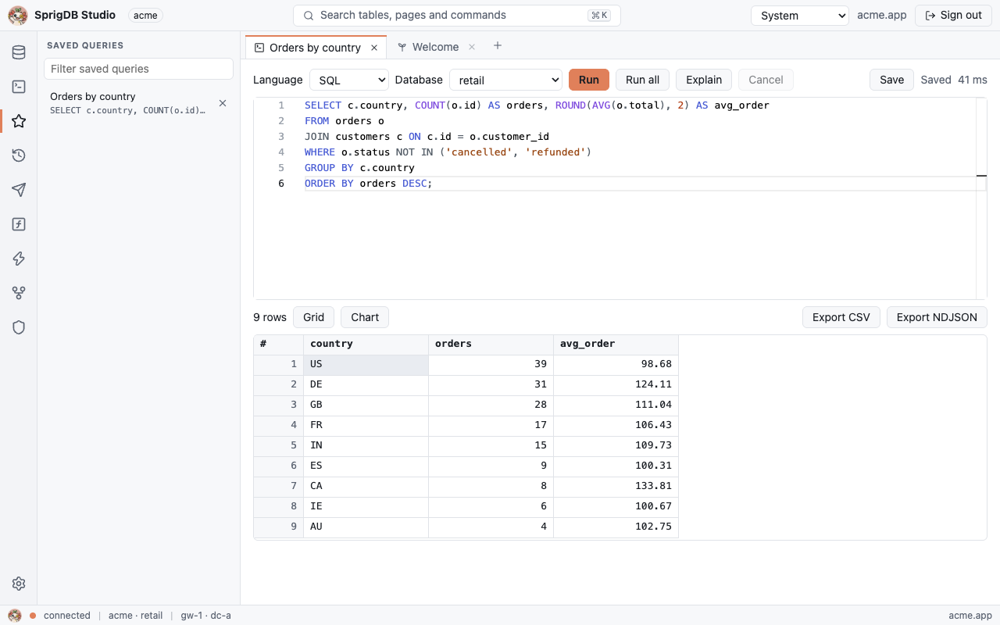

Both lists are stored per user in your tenant's catalog, not in the browser. They follow you to another browser, and the [`sprig`](../tools/sprig.md) shell shows the same ones. History keeps up to `studio.history_max` (500) runs per user.

Open query tabs are kept in this browser until you sign out, while `studio.persist_drafts` is on.

## 6. Look at the rest

A few places worth a first look:

- **Performance › Automatic indexing**: the indexes SprigDB built, recommendations waiting for a decision, and your slowest statements. See [Automatic indexing](../concepts/automatic-indexing.md).
- **Performance › Approvals**: the inbox of decisions waiting for you. See [Approvals](../concepts/approvals.md).
- **Performance › Shards**: table groups and their shards.
- **Access control › Users and access**: users, grants, API keys and the tenant tree.
- **Explorer › Redis**: a Redis console and key browser.

Forms in Studio never write behind your back: each one builds the SQL statement a client would run and shows it to you first.

## 7. Settings and themes

### Settings

Choose **Settings** (the gear at the bottom of the activity bar). It lists every setting at a **Scope**: the tenant, a database or a table, with the effective value, where it comes from (in bold when it is set at this scope) and the bounds in force. Type in **Filter keys** to narrow the list.

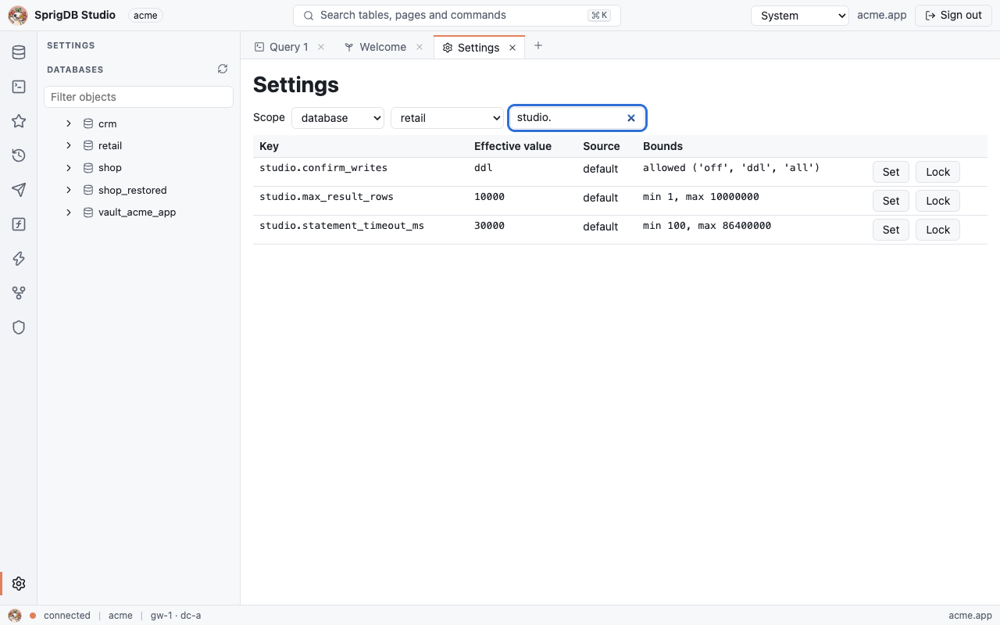

Try it: choose the scope **database**, the database `shop`, then **Set** on `studio.max_result_rows`. Enter `500` and select **Set**. Studio shows the statement:

```sql
ALTER DATABASE `shop` SPRIG SET (studio.max_result_rows = 500)
```

Choose **Run it**. Query results in `shop` now stop at 500 rows. **Reset** on the same row removes the value, and the tenant's applies again. See [Settings and scopes](../concepts/settings-and-scopes.md).

### Themes

The **Theme** menu in the title bar offers **System** (follows your operating system's light or dark preference), **Light**, **Dark** and **High contrast**. The editors and charts follow it. Your choice is kept in this browser. You can also switch from the command palette with **Switch theme**.

## 8. Sign out

**Sign out** in the title bar ends the session at once and clears what Studio kept in this browser. Sessions also end after `studio.session_idle_minutes` (30) without activity, with a **Still there?** warning two minutes before, and after `studio.session_max_hours` (12) in any case.

## Related

- [Studio](../tools/studio.md)
- [The sprig shell](../tools/sprig.md)
- [Your first tenant](first-tenant.md)
- [Settings and scopes](../concepts/settings-and-scopes.md)
- [Approvals](../concepts/approvals.md)
