# Studio

Studio is SprigDB's browser workspace. Every gateway serves it, at `/studio` on its HTTP listeners, so there is nothing to install. You sign in with your own SprigDB login and see exactly what your grants allow: Studio calls only the public REST API, with your token, as any other client would.

Use it to browse and edit data, write SQL, Cypher, GQL, MongoDB and Redis commands, look at query performance and automatic indexing, approve what SprigDB recommends, manage users, roles and row-level security, work with streams, queues and sinks, write logic, and, for platform operators, watch clusters, moves and jobs.

For a guided first look, see the [Studio tour](../get-started/studio-tour.md). The terminal counterpart is [the sprig shell](sprig.md), which shares your saved queries and history with Studio.

## Turning Studio on and off

Studio is on by default, at `http://<gateway>:8080/studio` and `https://<gateway>:8443/studio`. Its behaviour is set with `studio.*` settings, which all apply live, without a restart. Change them with `sprigctl settings set` (see [sprigctl](sprigctl.md)) or, at tenant, database and table scope, with SQL or Studio's own Settings page (see [Settings and scopes](../concepts/settings-and-scopes.md)).

```sh
sprigctl settings set studio.listeners https --scope global --reason "Studio over TLS only"
sprigctl settings set studio.session_idle_minutes 15 --scope tenant --tenant acme --reason "shorter sessions"
```

### Serving

| Setting | Type | Default | Scopes | Meaning |
|---|---|---|---|---|
| `studio.enabled` | bool | `true` | dc, global | Serve Studio. When off, Studio's paths answer 404 (39920 `ER_SPRIG_STUDIO_DISABLED`) |
| `studio.listeners` | text | `http,https` | dc, global | The HTTP listeners that serve Studio, comma-separated |
| `studio.path` | text | `/studio` | dc, global | The mount path; a value under `/v1`, `/admin` or `/.well-known`, or `/`, falls back to `/studio`. The Studio that ships with SprigDB is built for `/studio`, so keep the default |
| `studio.allow_insecure_http` | bool | `false` | dc, global | Allow sign-in over plain HTTP from another computer |
| `studio.public_origins` | text | empty | dc, global | Extra origins for the Origin check, comma-separated, for a reverse proxy in front of the gateway |
| `studio.map_tile_url` | text | empty | tenant, dc, global | A base-map tile server; its origin is added to the Content-Security-Policy |

Studio's files are built into the `sprigdb` binary. A binary built without them answers 503 with a page saying so (39932 `ER_SPRIG_STUDIO_NOT_BUILT`).

Every Studio response carries a strict Content-Security-Policy (scripts only from Studio itself; no inline scripts, no `eval`), `X-Frame-Options: DENY`, `X-Content-Type-Options: nosniff`, `Referrer-Policy: no-referrer`, same-origin opener and resource policies, a `Permissions-Policy` that denies the camera, microphone, geolocation and payment, and HSTS on 8443. Cookie requests from another site are refused (39922), as are cookie requests without Studio's `X-Sprig-CSRF` header (39923).

### Sessions

| Setting | Type | Default | Scopes | Meaning |
|---|---|---|---|---|
| `studio.session_idle_minutes` | int, 1 to 10080 | `30` | tenant, dc, global | Idle time before the session ends (39924) |
| `studio.session_max_hours` | int, 1 to 720 | `12` | tenant, dc, global | The longest a session lasts (39925) |
| `studio.persist_drafts` | bool | `true` | tenant, dc, global | Keep query tabs in the browser until you sign out |
| `studio.history_max` | int, 0 to 10000 | `500` | tenant, dc, global | Runs kept per user in the tenant's catalog, for Studio and `sprig`; `0` stops recording |

### Results and statements

| Setting | Type | Default | Scopes | Meaning |
|---|---|---|---|---|
| `studio.max_result_rows` | int, 1 to 10000000 | `10000` | object, database, tenant, global | Rows held per result in the browser |
| `studio.max_result_mb` | int, 1 to 4096 | `64` | dc, global | Browser memory per result |
| `studio.statement_timeout_ms` | int, 100 to 86400000 | `30000` | object, database, tenant, global | Statement timeout |
| `studio.confirm_writes` | `off`, `ddl`, `all` | `ddl` | object, database, tenant, global | Which statements ask before they run (see [Confirmations](#confirmations)) |
| `studio.cursor_idle_seconds` | int, 1 to 3600 | `60` | tenant, dc, global | Idle time before a "fetch more" cursor closes and its backend statement is killed |
| `studio.cursor_max_open` | int, 1 to 64 | `4` | tenant, global | Open cursors per user on one gateway; opening another closes the least recently used |
| `studio.export_ticket_seconds` | int, 5 to 3600 | `60` | dc, global | Life of an export ticket |
| `studio.import_batch_rows` | int, 1 to 100000 | `1000` | tenant, global | Rows per import transaction |
| `studio.import_max_mb` | int, 1 to 65536 | `1024` | tenant, global | The largest file Studio imports |
| `studio.feed_view_max_events` | int, 10 to 1000000 | `5000` | tenant, global | Events kept in the feed view |
| `studio.graph_max_elements` | int, 10 to 1000000 | `2000` | tenant, global | Nodes plus relationships the graph view draws |
| `studio.view_as` | `on`, `off` | `on` | tenant, dc, global | Allow the "view as a user" tester |

### Operator mode settings

| Setting | Type | Default | Scopes | Meaning |
|---|---|---|---|---|
| `studio.operator_mode` | `on`, `off` | `on` | dc, global | Offer operator mode |
| `studio.operator_mtls` | `off`, `required` | `off` | dc, global | Require a verified client certificate for operator mode; needs `listener.https.client_cert` set (see [TLS](../security/tls.md#operator-mode)) |
| `studio.operator_require_mfa` | bool | `false` | global | Require a session signed in with a second factor for operator mode |
| `studio.operator_logins` | text | empty | global | Tenant logins (`tenant.user`) that hold platform operator rights in Studio, comma-separated |

See [Operator mode](#operator-mode) below. The full list, with bounds, is in the [settings reference](../reference/settings.md).

## Signing in

Open `/studio` and sign in with your login, `tenant.user` (for example `acme.app`), and your password. Password managers and paste work in both fields.

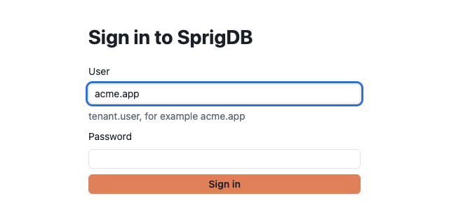

```text
https://gw.example.com:8443/studio
User:      acme.app
Password:  ********
```

Studio refuses to send a password over plain HTTP from another computer: the sign-in button is turned off and the page says to use `https`. The gateway refuses such a login too, with 39921 `ER_SPRIG_STUDIO_INSECURE_TRANSPORT`, unless `studio.allow_insecure_http` is on. Plain HTTP from the gateway's own machine (`127.0.0.1`, `localhost`) is allowed, which is how local development works.

### The session

After sign-in, the gateway sets an `HttpOnly` refresh cookie; the access token lives only in the page's memory, never in browser storage, and is refreshed at 80% of its life. Several tabs share one session: only one refreshes at a time and hands the new token to the others, because the gateway treats a reused refresh token as theft and ends the session.

Two minutes before `studio.session_idle_minutes` of inactivity, Studio asks "Still there?"; choose **Stay signed in** to carry on. Otherwise it signs you out. A session also ends after `studio.session_max_hours`, whatever you do. **Sign out** in the title bar ends it at once and clears what Studio kept in the browser.

### Second factors

A tenant can require a second factor for HTTP logins with `auth.mfa_required` (`off`, `admins` or `all`; see [Accounts and logins](../security/accounts-and-logins.md)).

- **Signing in with a factor.** After the password, Studio asks for the 6-digit code from your authenticator app, or one of your recovery codes.
- **Setting one up.** Go to **Access control > Security** and choose **Set up an authenticator app**. Scan the QR code (or type the secret, or open the `otpauth:` link on the device), then type the code it shows. Studio shows your recovery codes once: each signs you in once if you lose the device, so keep them somewhere safe. When your tenant requires a factor and you have none, Studio walks you through this before you finish signing in.
- **Removing it.** The Security page also shows how you signed in, whether a factor is required, and how many recovery codes are left. Removing the factor needs a current code or a recovery code, and signs out every session you have.

A tenant administrator can reset another user's factors from **Users and access** (see [Users](#users-and-access)).

### Impersonation

A tenant administrator (`SPRIG_TENANT_ADMIN`) can act as another user of the tenant for a while, to see what they see. In **Users and access**, choose **Impersonate** on the user, give a reason (it is recorded in the audit log) and a number of minutes. A banner across the top says "You are `<user>`, impersonated by `<you>`, until `<time>`", with **Stop impersonating**. Operator mode is not available while impersonating.

## The workspace

Studio's window has five parts:

```text
┌ SprigDB Studio   [tenant]   [Search tables, pages and commands  ⌘K]   [Theme]  acme.app  Sign out ┐
├──┬──────────────────┬───────────────────────────────────────────────────────────────────────────┤
│  │ Section's pages  │ [Welcome] [Query 1] [orders] [Automatic indexing] ...                      │
│▣ │                  │                                                                            │
│▶ │ Databases        │   the open page                                                            │
│★ │  ▾ shop          │                                                                            │
│⟲ │    orders        │                                                                            │
│… │    customers     │                                                                            │
├──┴──────────────────┴───────────────────────────────────────────────────────────────────────────┤
│ ● connected | acme · shop | gw-1 · dc-a                                               acme.app  │
└─────────────────────────────────────────────────────────────────────────────────────────────────┘
```

- **The title bar** has the tenant (a switcher, if you administer descendant tenants), the search box that opens the [command palette](#the-command-palette), the theme, who you are, and **Sign out**.
- **The activity bar** on the left picks a section. From the top: **Explorer**, **Query**, **Saved queries**, **History**, **Messaging**, **Logic**, **Performance** (with a badge counting approvals that wait), **Inheritance** and **Access control**; at the bottom, **Operator mode** (operators only) and **Settings**.
- **The side panel** lists the section's pages and, below them, the database tree. For Saved queries and History, it shows those lists instead.
- **The tabs** hold everything you have open: query tabs, tables, and pages. `Left` and `Right` move between tabs, and `Delete` (or a middle click) closes one.
- **The status bar** shows whether you are connected (and whether Studio is working), the tenant and database, the gateway and its data centre, and your login.

The tenant's home page welcomes you and lists your databases, with who you are signed in as, your session limits, your privileges and the gateway you reached. If you are a tenant administrator, the tenant switcher lists your home tenant and its descendants; choosing a descendant opens its settings. Settings and access can target a descendant; data views always use your home tenant.

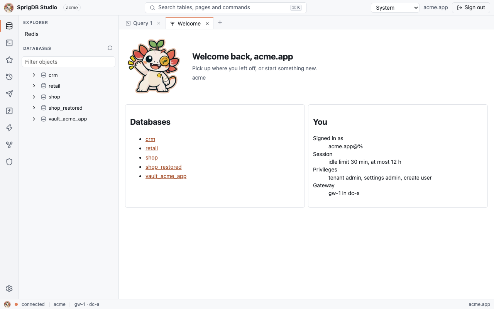

### The explorer

The database tree lists the databases you can see and, inside each, its tables (collections and key namespaces are tables too), views, graphs, procedures and functions. Type in **Filter objects** to narrow it; **Refresh** reloads it. The **Explorer** section also links to the [Redis console](#redis).

A database's page lists its objects with their kind, estimated rows and comment, with **New query** and a link to the database's settings.

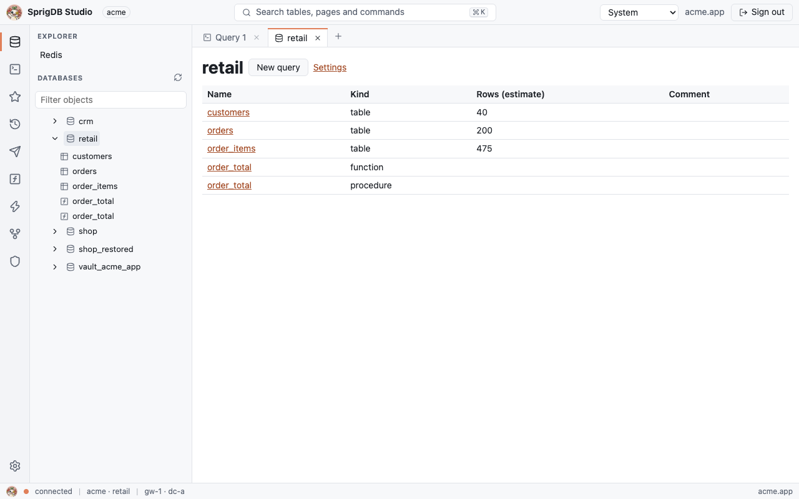

A [logic](../data-models/logic.md) function can appear twice in the tree and on this page, as a function and as a procedure of the same name: SprigDB creates a wrapper procedure for `CALL` and, when the code writes nothing, a stored function for `SELECT`.

### Object pages

Choosing an object opens its page:

| Object | Tabs |
|---|---|
| Table | Data, Columns, Indexes, Relations, Triggers, Policies, Inheritance, Shards, Definition |
| View | Data, Columns, Policies, Definition |
| Procedure, function | Definition |
| Graph | A button that opens a Cypher tab on it |

- **Data** is the [table data view](#the-table-data-view).
- **Columns** lists each column with its type, nullability, key, default and extra.
- **Indexes** shows `SHOW INDEX`, with each index's origin (yours, or created by [automatic indexing](../performance/automatic-indexing.md)).
- **Relations** lists foreign keys out of the table and into it.
- **Triggers** lists SQL triggers with their timing, event and statement.
- **Policies** lists the table's [row-level security](../security/row-level-security.md) policies; with none, every user with `SELECT` sees every row.
- **Inheritance** shows whether the table is inheritable (see [Inheritance](../data-models/inheritance.md)).
- **Shards** shows the table's table group and shards.
- **Definition** shows `SHOW CREATE`.

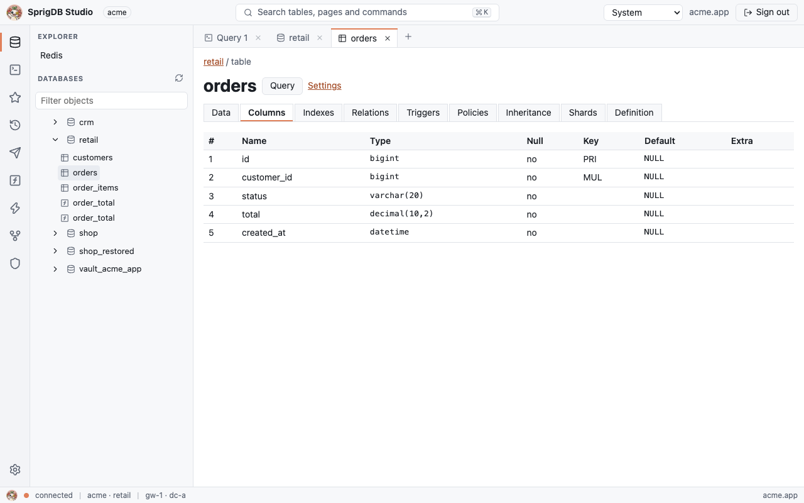

The page's **Query** button opens a query tab with `SELECT * FROM <table> LIMIT 100;` (or, for a graph, `MATCH (n)-[r]->(m) RETURN n, r, m LIMIT 25;`). A table's page also links to its **Settings**.

## The query editor

Open a query tab from the **Query** section, **New query**, or the palette. Each tab has a language, a database and, for graph languages, a graph.

| Language | Editor | Runs as |
|---|---|---|
| SQL | MySQL highlighting | SQL on the tab's database |
| Cypher | Cypher highlighting | Cypher on `<database>.<graph>` |
| GQL | Cypher highlighting | GQL on `<database>.<graph>` |
| MongoDB | JavaScript highlighting | A `mongosh` command on the tab's database |

The editor is Monaco, loaded the first time you open a tab. It completes keywords, databases, tables and columns from the catalog (and, for Cypher, the graph's labels, relationship types and property keys), and 500 ms after you stop typing it asks the gateway to check the statement and marks errors in place.

The MongoDB language is a `mongosh` subset that is parsed, never evaluated: a call chain rooted at `db` (`find`, `aggregate`, `insertOne`, `updateMany` and similar), literals, and the helpers `ObjectId`, `ISODate`, `NumberLong`, `NumberInt`, `NumberDecimal`, `Timestamp`, `UUID`, `BinData`, `MinKey` and `MaxKey`. Variables, functions, loops and anything else are errors with their position, so pasted text can't run code.

```js
db.events.find({ type: "click", at: { $gte: ISODate("2026-11-01T00:00:00Z") } }).sort({ at: -1 }).limit(20)
```

### Running

| Control | Does |
|---|---|
| **Run** (`Ctrl+Enter`, `⌘+Enter` on a Mac) | Runs the selection, or the statement at the cursor |
| **Run all** | Runs every statement in the tab, in order |
| **Explain** | Shows the plan of the statement at the cursor: `EXPLAIN FORMAT=JSON` for SQL, `EXPLAIN` for Cypher and GQL, or `explain` for a MongoDB command |
| **Cancel** | Stops the running statement |
| **Save** (`Ctrl+S`, `⌘+S`) | Saves the tab's text as a [saved query](#saved-queries-and-history) |

A statement stops at `studio.statement_timeout_ms` and says so. While it runs, the status shows "Running…"; when it ends, its time.

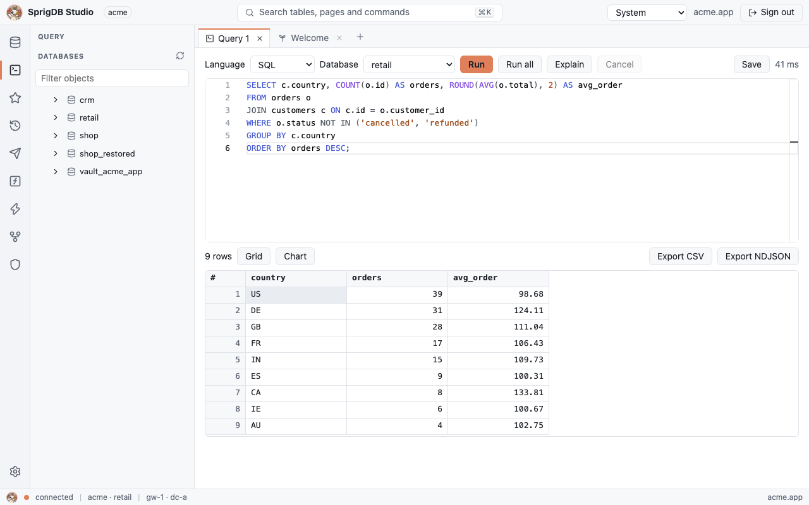

### Confirmations

Before a statement runs, Studio classifies it and, depending on `studio.confirm_writes`, shows it with "Run this statement?" and the target database:

| `studio.confirm_writes` | Asks before |
|---|---|
| `off` | Nothing |
| `ddl` (default) | DDL, account statements and statements it can't classify |
| `all` | Everything except reads and session statements |

Studio's forms (users, roles, policies, settings, messaging, logic) never write directly: each builds the statement a SQL client would run and shows it before it runs.

### Results

Rows stream in as the gateway sends them. Studio holds up to `studio.max_result_rows` rows and `studio.max_result_mb` of each result, and says when it stopped. Then:

- **Fetch more** continues the same run through a cursor on the gateway, with a sliding window: earlier rows are dropped to keep the cap in the browser, and the notice says which rows you are seeing. A cursor holds no backend session of its own. It closes when you start a new run, leave the result or hide the tab, and the gateway closes it after `studio.cursor_idle_seconds` (39935). **Fetch more** after that runs the statement again, skips the rows already read, and says so, because rows from there on can differ if the data changed.
- **Export CSV** and **Export NDJSON** run the statement again on the gateway and stream every row to a download, whatever the cap. The download uses a one-time ticket that lives `studio.export_ticket_seconds` and never appears in a URL; a bad or expired ticket fails with 39929.

A result has up to four views:

| View | For | Notes |
|---|---|---|
| **Grid** | Every result | Virtual scrolling; arrows, `PageUp`/`PageDown`, `Home`/`End`, `Ctrl+Home`/`Ctrl+End` move between cells |
| **Chart** | Rows | A bar or line chart: the first column as categories, numeric columns as series. The grid is the accessible alternative |
| **Graph** | Cypher and GQL results with nodes or relationships | Draws up to `studio.graph_max_elements` elements. Selecting a node or relationship shows its labels and properties; **Expand neighbours** fetches a node's neighbours with a bounded query, as you |
| **Tree** | MongoDB results | Each document as a folding JSON tree, with a type badge on every value |

Studio opens a graph result as a graph and a MongoDB result as a tree; you can switch views at any time.

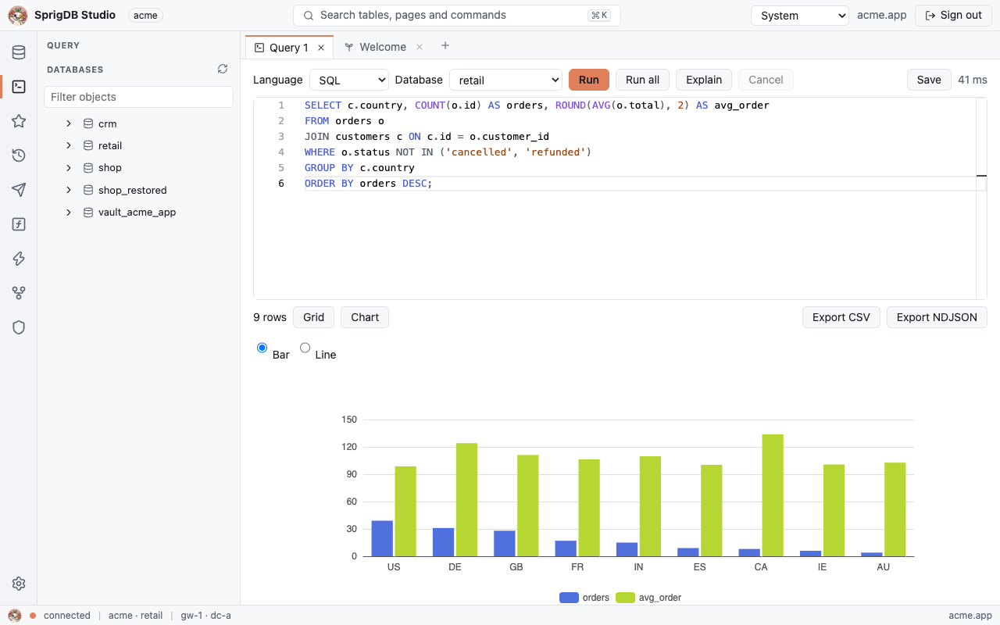

### Editing documents

In the Tree view of a MongoDB result, you can edit a value and keep its type, or change the type badge (`str`, `int`, `long`, `dbl`, `dec`, `bool`, `oid` and the others). Saving updates the document by `_id`, setting only the paths you edited, and also requires every top-level field to be as you read it. If someone changed the document in the meantime, nothing is overwritten: Studio shows the original, the current and your version. Exports of documents are canonical Extended JSON.

## The table data view

A table's **Data** tab shows pages of 100 rows in primary-key order, with **Previous page** and **Next page**.

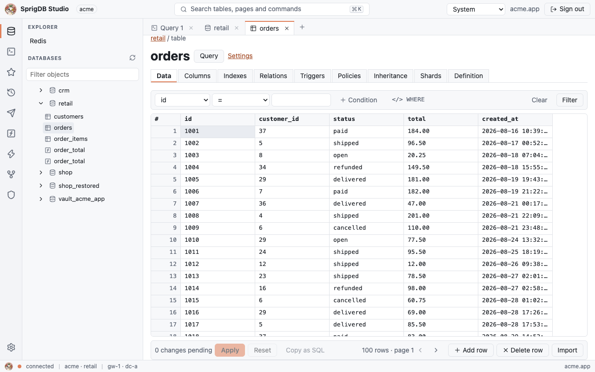

### Filtering

The filter bar builds a `WHERE` clause from conditions on columns, joined with `AND`. Each condition takes one of `=`, `!=`, `<`, `<=`, `>`, `>=`, `LIKE`, `NOT LIKE`, `IN` (a comma-separated list), `IS NULL` or `IS NOT NULL`. **Condition** adds a condition, **Filter** applies them, and **Clear** shows every row again. **</> WHERE** (Write the WHERE clause yourself) switches to a text box. The clause is your own SQL, run with your own rights, like anything typed in a query tab.

### Staged edits

Edits are staged until you apply them:

1. Double-click a cell, or press `Enter` or `F2`, to edit it; `Enter` keeps the value and `Escape` drops it.
2. **Add row** adds an empty row at the end of the page; **Delete row** marks the row that has the focus (the cell you last clicked or moved to) for deletion.
3. The bar counts the changes pending. **Copy as SQL** copies them as statements, **Reset** drops them, and **Apply** shows the statements; **Run them** writes them all in one transaction.

Changed cells are highlighted, new rows are marked as added, and a row marked for deletion is struck through:

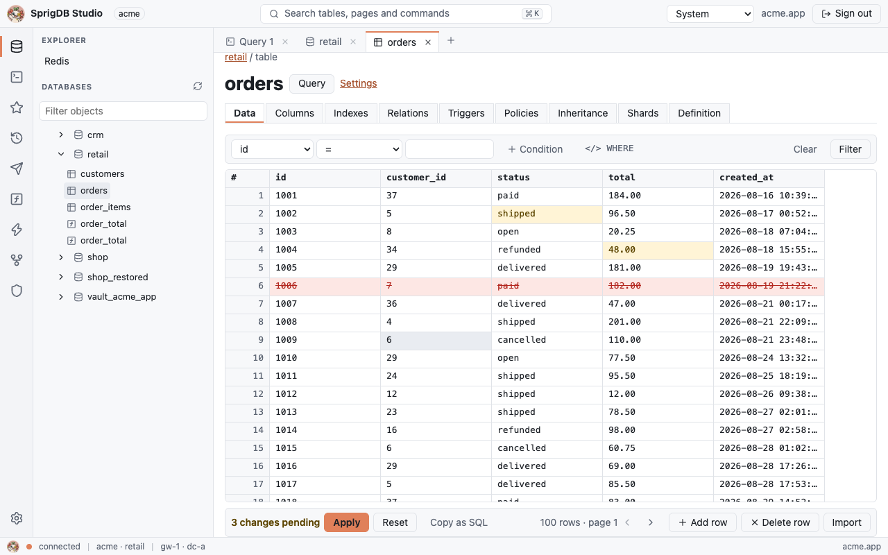

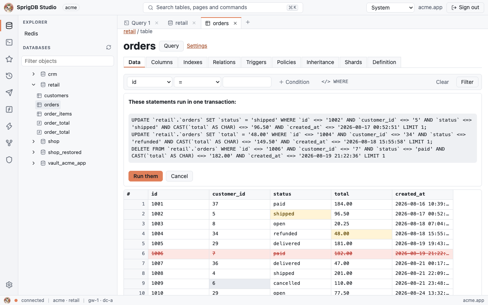

Each `UPDATE` and `DELETE` names its row by every column as it was read, NULL-safely, so a row that someone changed since you read it matches nothing. Then the whole transaction rolls back and Studio says "Someone changed these rows since you read them", showing for each row the original, the current values (or "(deleted)") and yours. Choose **Keep mine (save against current)** to apply your edits over the current values, or **Take current** to reload.

A table without a primary key is read-only here, because its rows can't be named. Generated, binary and SprigDB's internal (`_sprig_…`) columns can't be edited.

### Importing

**Import** on the Data tab loads a CSV file (RFC 4180, with a header row; `\N` and empty unquoted fields are NULL) or an NDJSON file (one object per line) into the table:

- rows go in as `INSERT` statements in batches of `studio.import_batch_rows`, each its own transaction;
- a progress bar counts rows; when a batch fails, Studio finds the rejected rows one by one, lets the others in, and lists the rejected rows with their errors;
- **Resume at row** restarts an interrupted import where it stopped.

A file over `studio.import_max_mb` is refused. Load a larger CSV with `LOAD DATA LOCAL INFILE` from a MySQL or MariaDB client (see [MySQL and MariaDB](../connect/mysql-and-mariadb.md)), or move a whole tenant with `sprigctl tenant import` (see [Backups and moves](../operate/backups-and-moves.md)).

## Saved queries and history

**Saved queries** (the star) and **History** (the clock) in the activity bar switch the side panel to those lists, each with a filter. Choosing an entry opens it in a query tab; saved queries can be deleted, and history cleared.

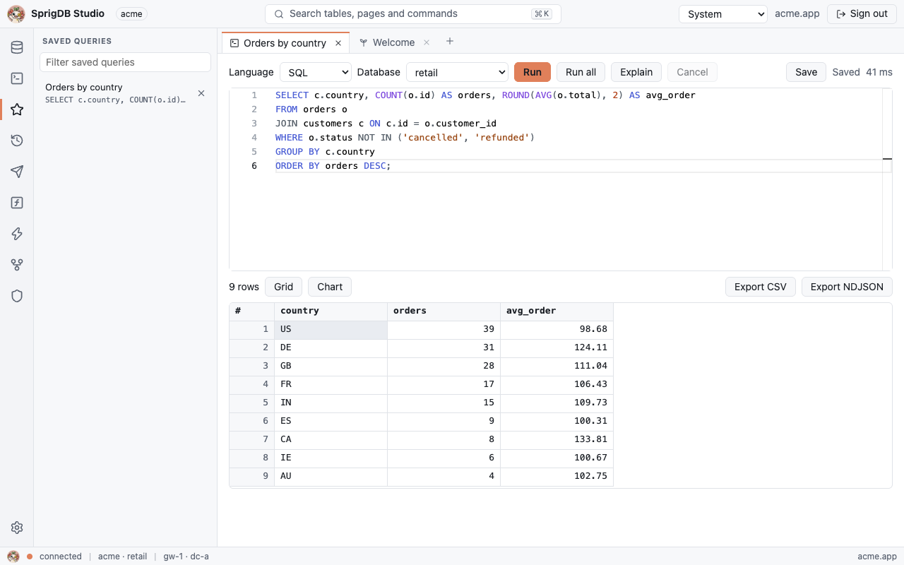

Both are kept per user in the tenant's catalog, so they follow you between browsers and are the same ones [`sprig`](sprig.md) shows. History keeps up to `studio.history_max` runs per user. When the gateway can't keep them for your login (for example a login from an accounts file), Studio keeps them in the browser while `studio.persist_drafts` is on, or for the session otherwise, and says so; queries saved in the browser before the catalog could keep them move there the first time it answers.

Query tabs (their text, database and title) are kept in the browser's IndexedDB per tenant and user while `studio.persist_drafts` is on, until you sign out. Other per-browser preferences, such as the theme, are kept in `localStorage`. Studio never keeps tokens or results in browser storage.

## Performance

The **Performance** section has four pages.

### Automatic indexing

Four views of [automatic indexing](../performance/automatic-indexing.md), which you can filter to a database or table:

- **Indexes**: each index with its columns, state, estimated net benefit, and size. Choose an index to see its evidence: the rollout per shard, the target fingerprints before and after, validations and history.
- **Recommendations**: indexes waiting for a decision. **Approve** builds one; **Dismiss** rejects it.
- **Fingerprints**: the tenant's statements by total time over the last hour, 24 hours or 7 days, from applications, Studio or both, with a p95 latency series per fingerprint over 7 days.
- **Explain a query**: the plan of a fingerprint.

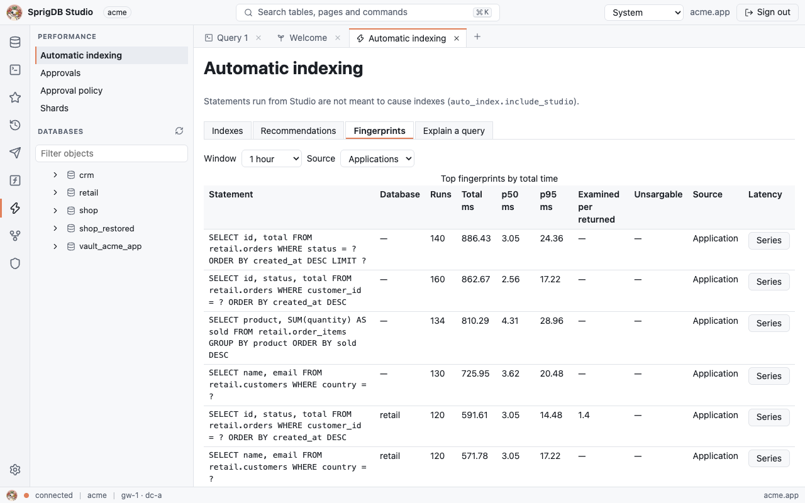

**Freeze** pins an index so automatic indexing leaves it alone; **Unfreeze** releases it. Acting needs the right privileges on the database; otherwise the page says "view only". Statements run from Studio don't count toward automatic indexing unless `auto_index.include_studio` is on.

### Approvals

The approvals inbox lists the recommendations SprigDB holds for a decision (see [Approvals](../concepts/approvals.md)). Filter by kind (`index`, `vector`, `shard`, `advisor`, `balancer`, `dc`, `standby`, `failover`, `graph`), state (`open`, `approved`, `applying`, `applied`, `failed`, `ignored`, `snoozed`, `superseded`, `expired`) and level (`table`, `database`, `tenant`, `dc`, `platform`). Choose an item to see its evidence and history, then **Approve**, **Approve in a window**, **Ignore**, **Snooze** or **Comment**. Select several to approve, ignore or snooze them together. What you see and may act on follows your grants. The badge on the Performance icon counts open items and refreshes every minute.

### Approval policy

The policy page shows, for the tenant, a database or a table, every kind's mode, where its value comes from, the level a new item goes to, and its escalation and auto-apply timers. You change these values with SQL or on the Settings page. The page also holds your own email subscription to the inbox: an address and `immediate`, `daily digest` or `off`.

### Shards

Two tabs:

- **Table groups**: each table's routing, key columns and parent, and each group's shards with their hash range, cluster, state, epoch and any running job. You see tables in the databases you hold grants on.
- **Advisor runs**: the [sharding advisor](../performance/sharding-advisor.md)'s runs with their cause, mode, status, verdict, best score, confidence and times. These cover every database, so they need `SPRIG_TENANT_ADMIN` or a grant on `*.*`.

## Access control

### Users and access

Four tabs:

- **Users**: every account with its host, kind, authentication methods and state (open, locked, password expired). **Grants** shows `SHOW GRANTS`; **Password** sets a password. Administrators also get **Lock**/**Unlock**, **Reset factors** (removes the user's second factors and ends their sessions), **Impersonate** (tenant administrators, for other users) and **Drop**, which asks you to type the user's name. A form creates users.
- **Grants**: grant or revoke privileges on a database or table to a user, with or without `WITH GRANT OPTION`.
- **API keys**: your keys (or, for administrators, everyone's) with **Revoke**. A form creates a key with a name, an optional user (administrators) and an expiry in days; the key is shown once, until you choose **I have copied it**. See [API keys and tokens](../security/api-keys-and-tokens.md).
- **Tenants**: the tenants you can see, their paths, and whether you are a user there or an administrator above it. Child tenants are created with `sprigctl tenant create`.

### Roles and policies

- **Roles**: create a role, show its grants, grant privileges to it and grant it to users (see [Grants and roles](../security/grants-and-roles.md)).
- **Row-level security policies**: a policy editor for a table, with the `USING` expression in Monaco and the session functions it can use: `CURRENT_USER()`, `SPRIG_USER_ID()`, `SPRIG_TENANT_ID()`, `SPRIG_HOME_TENANT_ID()`, `SPRIG_CLAIM('sub')`, `SPRIG_USER_ATTR('k')` and `SPRIG_SESSION_SPACE()`. Buttons switch the table's row-level security (`ENABLE`, `DISABLE`, `FORCE`, `NO FORCE`), and the list shows the database's policies with **Drop…**.
- **View as a user**: runs one read-only statement as another user of the tenant, or of a descendant tenant, with their privileges and policies, capped at `studio.max_result_rows`. You can simulate claims (`SPRIG_CLAIM`) and attributes (`SPRIG_USER_ATTR`) as JSON. It is for tenant administrators, never shows more than you could see yourself, is audited as `studio.view_as`, and is off when `studio.view_as` is `off`. A user it isn't allowed for fails with 39930; a statement that might write fails with 39931.

### Security

Your own second factor: see [Second factors](#second-factors).

## Messaging

The **Messaging** section works on one database (for queues, its virtual host), chosen at the top, with four tabs. Lists come from the same statements a SQL client runs (`SHOW STREAMS`, `SHOW SINKS`, `SHOW SINK STATUS`, `SHOW INHERITED …`), so you see only what you may read, and every change is a statement shown before it runs. See [Streams, queues and sinks](../sql/streams-queues-sinks.md).

- **Streams**: the database's streams; **Create a stream** with a name, partitions, retention and cleanup (`delete` or `compact`). A stream's page shows its partitions and consumer groups with their lag, and **Read records** reads from a partition and offset with a limit, as a `SELECT` that never commits an offset. **Drop stream…** removes it.
- **Queues**: the exchanges, bindings and queues, with each queue's ready and unacknowledged messages and consumers, refreshed every 5 seconds. A queue's page has **Browse** (look without taking or locking), **Get 10 and requeue** (they count as redelivered), **Purge…** and **Republish** (move messages to an exchange); purge and republish say what they do before they run. A test-publish form sends a message to an exchange. The queue engine checks your queue permissions on each.
- **Sinks**: the database's sinks and connections. Connection forms create and change connections; credentials are write-only (password fields, shown as `********` in the statement, kept nowhere). Sinks go to a connection (webhook, Kafka, S3, a database) or to a script in JavaScript, Lua or KIRun. **Test** runs a connection's checks step by step (credentials, options, connect, metadata), and can write one marked test record; a new connection or sink can be tested before it is saved, which creates nothing. A sink's dry run applies its filter, columns and transform to the source's latest records and delivers nothing. A sink's page has **Pause…**, **Resume…**, **Reset to earliest…** and **Reset to latest…**, and its dead letters with **Replay** and **Discard**.
- **Inherited**: messaging definitions declared here, their instances, and overrides by level (see [Inheritance](../data-models/inheritance.md)).

## Logic

The **Logic** section lists the database's functions, procedures, triggers and validations and opens editors for them (see [Logic](../data-models/logic.md)):

- **JavaScript** and **Lua** in Monaco; **KIRun** in the visual KIRun editor, with its step graph and text form, which knows SprigDB's own functions (`Sprig.Db.*`, `Sprig.Http.Fetch`, `Sprig.Mq.*`).
- A new function or procedure takes a name, parameters, a return type (functions), security (`INVOKER` or `DEFINER`) and a tier preference (`auto`, `mariadb` or `engine`).
- **Check** compiles without deploying, shows which tier the code runs in and why ("Why not MariaDB"), and, for users with `ALTER ROUTINE`, the generated SQL. Errors are marked on their line, or on the step's name for KIRun.
- **Deploy** shows and runs the statement. A function or procedure can be deployed to a share of callers first, picked by caller or by tenant.


A module's page has these tabs:

| Tab | Shows |
|---|---|
| Code | The editor; needs `ALTER ROUTINE`, `CREATE ROUTINE` or `ALL` on the database |
| Versions | Each version, with **Roll back to this** |
| Rollout | Functions and procedures: the stage and each version's numbers, refreshed every 5 seconds; move, promote or abort. When the gateway rolled a candidate back by itself, the reason |
| Test run | Runs the deployed version or your draft with arguments, a trigger's or validation's row and operation, a stream record or queue message, snapshot rows, and answers for `fetch` calls; always rolled back. The report shows each statement with its kind, rows and time, the writes, logs, outbound calls, the snapshot tables after the run, budgets and timing |
| Logs | The module's logs, followed as they come |
| Dead letters | Failed events by state (`dead`, `replaying`, `replayed`, `discarded`), with **Replay** and **Discard** |

Dropping a module shows what still uses it.

## Inheritance

The **Inheritance** page is read-only (see [Inheritance](../data-models/inheritance.md)):

- **Inheritable tables**: each table's origin level and group;
- **Shares and their groups**: the shares, the tables they carry, and each granted share's definition;
- **Why a delete is refused**: for a delete refused with 1451, which rows still reference the ones you tried to delete.

## Redis

The Redis page (under **Explorer**) has a console and a key browser for one key-value namespace, chosen by database and name; the defaults are database `redis` and namespace `db0`. Each console line is one command, split as `redis-cli` splits it, completed and checked against the command table, and its reply is printed as `redis-cli` prints it. Writes are confirmed under `studio.confirm_writes`; `FLUSHDB`, `FLUSHALL` and `SWAPDB` always ask. The key browser lists keys with their type and TTL; a string can be edited, and other types show their contents. See [Redis](../connect/redis.md).

## Settings

The **Settings** page shows every setting at a scope you choose: the tenant, a database, or a table. **Filter keys** narrows the list. Each row has the key, the effective value, the scope it comes from (bold when it is set here) and the bounds in force. Tenant administrators set values at tenant, database and table scope, and at a descendant tenant's; wider scopes show read-only, as sources. Setting a value shows the statement first; the browser checks the bounds, and the gateway decides (39080 to 39084). **Reset** appears on a key set at this scope and removes the value. Settings administrators also get **Lock**, which shows `ALTER … SPRIG SET BOUNDS (<key> LOCKED)` so that narrower scopes can't set the key. See [Settings](../sql/settings.md).

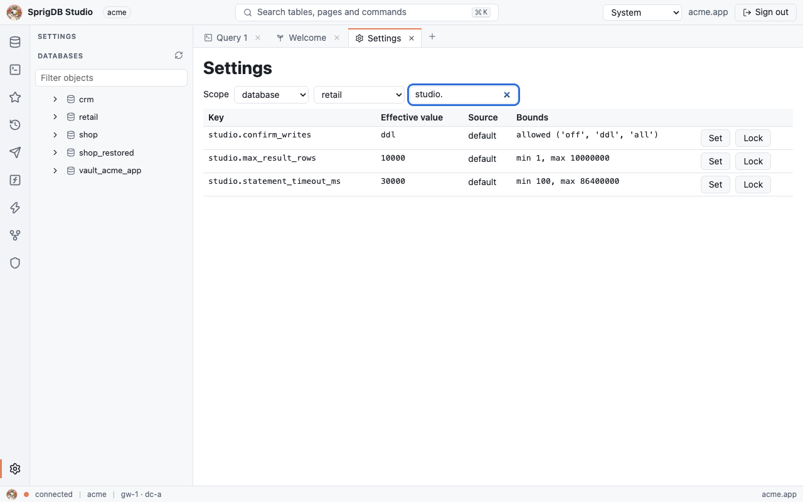

## Operator mode

Operator mode is for platform operators. It opens at `/studio/ops/` and has its own pages:

| Page | Shows |
|---|---|
| Data centers | Each DC's kind, state, epoch and whether it votes in the global tier, and measured latency between DCs |
| Clusters | Each cluster's id, name, DC, topology, state, nodes and server version |
| Tenants and placement | Each tenant's id, state, home DC and children; a tenant's shards with their cluster, size, load and pinning, and the clusters it could use with how full they are; **Run the sharding advisor** |
| Moves and splits | The mover's jobs with rows copied, catch-up lag and cutover holds; **Cancel** |
| Jobs | Every job with its owner, attempts, start and error |
| Failovers | The failover records |
| In-doubt transactions | Cross-shard transactions waiting for resolution |

Every action asks you to type the target's name and a reason, which is audited.

### Signing in as a named operator

Operators are created with `sprigctl operator create` (see [sprigctl](sprigctl.md)). Open `/studio/ops/clusters`, and Studio asks for the operator's name and password. The first sign-in sets up a second factor (scan the QR code, type the code) and shows the recovery codes once; later sign-ins take a code or a recovery code. The controller checks the operator's role, data centres and scopes on every call and audits the person. **Sign out** ends the operator session; **Leave operator mode** goes back to your tenant workspace.

With `studio.operator_mode` off, operator mode is refused (39928). With `studio.operator_mtls` set to `required`, it needs a connection with a verified client certificate (39927): set `listener.https.client_cert` to `optional` and `tls.bundles.default.client_ca_path` to your operators' CA, and install the operator's certificate in the browser. See [TLS](../security/tls.md#operator-mode).

### Operator logins

A tenant login listed in `studio.operator_logins` also gets operator mode, with the **Operator mode** icon in its activity bar. Its calls go to the DC leader's Admin API with the gateway's own `[gateway] operator_token_file` (see [Configuration](../operate/configuration.md)), as `studio:<tenant>.<user>`, and each write needs a reason. With `studio.operator_require_mfa`, the session must have signed in with a second factor (39926). This way of reaching operator mode is deprecated, and Studio says so on every page; use named operators.

## The command palette

`Ctrl+K` or `Ctrl+P` (`⌘+K`, `⌘+P` on a Mac), or the search box, opens one search over pages, open tabs, databases, the objects of databases already loaded, and commands: **New query tab**, **Switch theme** and **Sign out**. Type part of a name; matches rank by how early and how closely they match. `Up` and `Down` choose, `Enter` opens, and `Escape` closes.

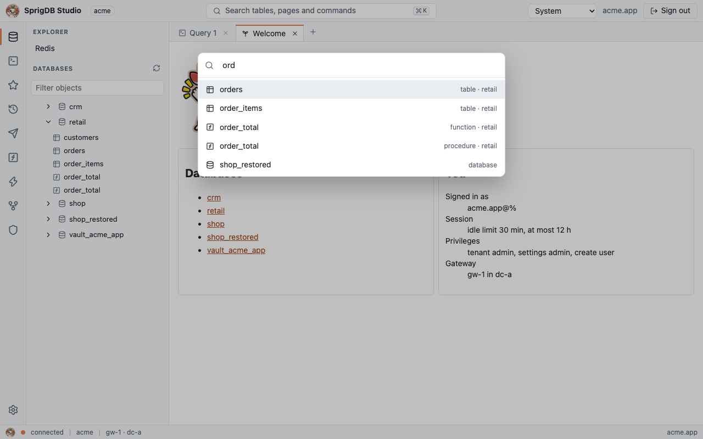

## Keyboard shortcuts

| Keys | Where | Does |
|---|---|---|
| `Ctrl+K`, `Ctrl+P` (`⌘` on a Mac) | Anywhere | Open or close the command palette |
| `Ctrl+Enter` (`⌘+Enter`) | Query editor | Run the selection or the statement at the cursor |
| `Ctrl+S` (`⌘+S`) | Query tab | Save the query |
| `Left`, `Right` | Tab bar | Previous or next tab |
| `Delete`, middle click | Tab bar | Close the tab |
| Arrows, `PageUp`, `PageDown`, `Home`, `End` | Grid | Move between cells |
| `Ctrl+Home`, `Ctrl+End` | Grid | First or last cell |
| `Enter`, `F2` | Editable grid | Edit the cell |
| `Enter`, `Escape` | Cell being edited | Keep or drop the value |
| `Up`, `Down`, `Enter`, `Escape` | Command palette | Choose, open, close |

## Themes and accessibility

The theme menu offers **System** (follows the operating system's light or dark preference), **Light**, **Dark** and **High contrast**. The editors and charts follow it.

Studio is built to be used with a keyboard and a screen reader:

- a **Skip to content** link is the first thing on every page;
- every control has a label, and the activity bar, tabs, grids and dialogs use their proper roles;
- the grid is the accessible alternative to charts and the graph view, and every result has it;
- the session warns two minutes before it ends for inactivity, and one click keeps it;
- animations are turned off when the system asks for reduced motion;
- sign-in fields accept paste and password managers.

Studio is in English.

## Related

- [Studio tour](../get-started/studio-tour.md)
- [The sprig shell](sprig.md)
- [sprigctl](sprigctl.md)
- [Settings and scopes](../concepts/settings-and-scopes.md)
- [Settings reference](../reference/settings.md)
